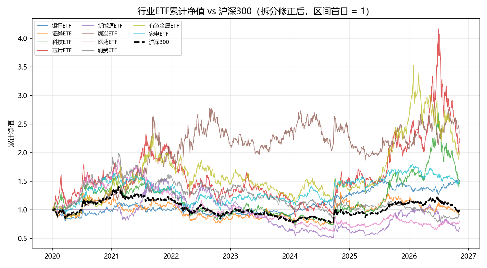
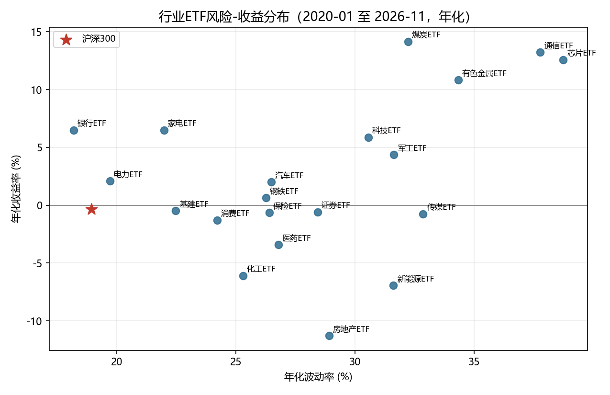

## About Me

I am ZHANG ZIYANG, a graduate student at the University of Macau taking
CISC7204 Data Science and Data Visualization. I enjoy turning market questions
into clear, reproducible analyses, and this portfolio collects the projects I
built while practising the full data-science workflow: framing a research
question, acquiring and cleaning data, running statistical models, and
communicating results visually.

## Technical Skills

- Python: pandas, NumPy, statsmodels, arch, matplotlib
- Econometrics: CAPM regression, stationarity tests, cointegration, GARCH volatility models
- Data cleaning: corporate-action (split/dividend) adjustment, missing-data handling
- Visualization: Plotly interactive dashboards, matplotlib static figures
- Version control and documentation with Git and GitHub

## Featured Project: Industry ETF Rotation & Risk Dashboard

### Research Question

How do A-share industry ETFs differ in market exposure, alpha, volatility and
money-flow behaviour relative to the CSI 300 index, and does sector rotation
show up across volatility regimes?

### Approach

I downloaded daily prices for 20 industry ETFs and 5 benchmark indices
(2020-2026) from Tushare Pro, cleaned unadjusted prices by detecting 12
split/dividend jumps, and built momentum, volatility, drawdown and rolling-beta
indicators. I then estimated CAPM betas with HAC standard errors, ran
stationarity and cointegration tests, fitted GARCH(1,1) volatility models, and
published everything as a single-page interactive dashboard.

### Visualization

### Findings

CAPM betas sort sectors as expected, from 0.50 (banks) to 1.31 (chips), but
after HAC correction none of the 20 ETFs shows a statistically significant
alpha — sector returns are largely explained by market exposure. Split
adjustment materially changes conclusions: the banking ETF flips from a
negative to a positive annualised return (+6.5%) once its 2025 split is
corrected.

### Limitation

The analysis describes this sample of A-share industry ETFs only; the
split-detection rule is heuristic and may miss small distributions, and no
transaction costs are considered, so signals are descriptive rather than a
tradable strategy backtest.

### Project Repository

[View the code and README](https://github.com/ZhangZiYang2026/data-science-project)

### Live Dashboard

[Try the interactive dashboard](dashboard/index.html)

### Status

Completed
